# Lanka Renters — Use Case Diagram

## Overview
This document specifies the comprehensive Use Case model for the **Lanka Renters** vehicle rental ecosystem. The system serves four distinct authenticated user roles (**Customer**, **Vehicle Owner**, **Driver**, and **System Administrator**) alongside external services (Payment Gateway, Notification Subsystem, Mapping Services).

```mermaid
flowchart TB
    %% Actors
    Customer(["👤 Customer"])
    Owner(["👤 Vehicle Owner"])
    Driver(["👤 Driver"])
    Admin(["🛡️ System Administrator"])
    Gateway["💳 Payment Gateway"]
    MapAPI["🗺️ Google Maps API"]

    %% Subsystem: Authentication & KYC
    subgraph Sub_Auth ["Authentication, Profile & Verification"]
        UC_Register["Register Account"]
        UC_Login["Login / Session Auth"]
        UC_KYC_Cust["Submit NIC & Driving License"]
        UC_KYC_Owner["Submit Business Reg & Owner Proof"]
        UC_KYC_Driver["Submit Driver License & Experience"]
        UC_ReviewKYC["Review & Approve/Reject KYC"]
        UC_ProfileChange["Submit Profile / Account Change Request"]
        UC_ReviewProfile["Approve/Reject Profile Changes"]
    end

    %% Subsystem: Vehicle Fleet & Inspection
    subgraph Sub_Fleet ["Fleet Management & Inspections"]
        UC_AddVehicle["Add Vehicle & Spec Details\n(AC, Fuel, Mileage, Deposit)"]
        UC_UpdateVehicle["Update Vehicle Details & Availability"]
        UC_OwnerPreInsp["Perform Pre-Rental Inspection\n& Upload Condition Photos"]
        UC_OwnerPostInsp["Perform Post-Rental Inspection\n& Upload Return Photos"]
        UC_CustViewInsp["View Inspection Report & Photos"]
        UC_DailyCheck["Daily Vehicle Safety Check"]
    end

    %% Subsystem: Bookings & Agreements
    subgraph Sub_Booking ["Booking & Rental Operations"]
        UC_SearchVehicles["Search & Filter Vehicles"]
        UC_ViewChecklist["View Vehicle Details & Pre-Booking Checklist"]
        UC_CreateBooking["Create Booking & Sign Legal Agreement"]
        UC_ApproveBooking["Approve / Reject Booking Request"]
        UC_ConfirmPickup["Confirm Vehicle Pickup & Handover"]
        UC_RequestDriverChange["Request Driver Change"]
        UC_ReviewDriverChange["Review & Approve/Reject Driver Change"]
        UC_CancelBooking["Cancel Booking"]
    end

    %% Subsystem: Payments & Financials
    subgraph Sub_Financials ["Payments, Invoicing & Settlements"]
        UC_MakePayment["Pay Rental Fees & Key Money Deposit"]
        UC_ViewInvoice["Download / View Itemized Invoice"]
        UC_ProcessSettlement["Calculate & Execute Owner Settlement"]
        UC_PayDriver["Disburse Driver Payment"]
    end

    %% Subsystem: In-Rental Incidents & Support
    subgraph Sub_Incidents ["Incident Management & Support"]
        UC_ReportIncident["Report Incident\n(GPS, District, Photos, Police Report)"]
        UC_ReviewIncident["Investigate & Resolve Incident"]
        UC_AssignReplacement["Assign Replacement Vehicle"]
        UC_AcceptReplacement["Review & Accept/Decline Replacement"]
        UC_Chat["In-Rental Chat (Customer, Owner, Driver)"]
        UC_LeaveReview["Submit Rating & Review"]
    end

    %% Actor Relationships: Customer
    Customer --> UC_Register
    Customer --> UC_Login
    Customer --> UC_KYC_Cust
    Customer --> UC_ProfileChange
    Customer --> UC_SearchVehicles
    Customer --> UC_ViewChecklist
    Customer --> UC_CreateBooking
    Customer --> UC_ConfirmPickup
    Customer --> UC_RequestDriverChange
    Customer --> UC_CancelBooking
    Customer --> UC_MakePayment
    Customer --> UC_ViewInvoice
    Customer --> UC_CustViewInsp
    Customer --> UC_ReportIncident
    Customer --> UC_AcceptReplacement
    Customer --> UC_Chat
    Customer --> UC_LeaveReview

    %% Actor Relationships: Vehicle Owner
    Owner --> UC_Login
    Owner --> UC_KYC_Owner
    Owner --> UC_AddVehicle
    Owner --> UC_UpdateVehicle
    Owner --> UC_ApproveBooking
    Owner --> UC_OwnerPreInsp
    Owner --> UC_OwnerPostInsp
    Owner --> UC_ReviewDriverChange
    Owner --> UC_Chat
    Owner --> UC_ProcessSettlement

    %% Actor Relationships: Driver
    Driver --> UC_Login
    Driver --> UC_KYC_Driver
    Driver --> UC_DailyCheck
    Driver --> UC_Chat
    Driver --> UC_PayDriver

    %% Actor Relationships: Admin
    Admin --> UC_Login
    Admin --> UC_ReviewKYC
    Admin --> UC_ReviewProfile
    Admin --> UC_ReviewIncident
    Admin --> UC_AssignReplacement
    Admin --> UC_ProcessSettlement
    Admin --> UC_PayDriver

    %% External Systems
    UC_MakePayment -.-> Gateway
    UC_ReportIncident -.-> MapAPI
```

## Detailed Actor Descriptions

| Actor | Role Definition | Primary Responsibilities |
|---|---|---|
| **Customer** | End-user renting vehicles for self-drive or with a professional driver. | Searches vehicles, reviews requirements, accepts booking agreements, pays rentals/deposits, completes handover confirmation, requests driver changes, reports road incidents, reviews replacements, and rates trips. |
| **Vehicle Owner** | Fleet partner supplying private or commercial vehicles to the platform. | Registers vehicles, defines rental specs (mileage limits, key money, monthly prices), conducts pre- and post-rental photo inspections, approves bookings, reviews driver change requests, and receives net earnings settlements. |
| **Driver** | Verified professional chauffeur assigned to bookings requiring driver services. | Submits license and qualifications, maintains active availability and leave schedules, performs pre-trip safety checklists, navigates passenger trips, and tracks assigned earnings. |
| **System Administrator** | Platform operator overseeing safety, compliance, dispute handling, and financial settlements. | Conducts KYC verification for all parties, reviews profile change requests, investigates incidents, issues replacement vehicles or refunds, audits driver changes, and publishes system announcements. |
| **Payment Gateway** | External financial processing entity. | Securely handles credit/debit card transactions, pre-authorizations, refund handling, and transactional receipt issuance. |
| **Google Maps API** | External geospatial mapping service. | Geocodes incident locations, visualizes breakdown coordinates for rapid emergency response and dispatch. |
