# Lanka Renters — Class Diagram

## Overview
This diagram depicts the Object-Oriented software architecture of the **Lanka Renters** platform. Built upon native PHP 8.2 MVC patterns without heavyweight frameworks, it illustrates the helper foundation, domain models, controller orchestration, and data access layers.

```mermaid
classDiagram
    %% Core Infrastructure & Helpers
    class Database {
        -PDO connection
        -static Database instance
        -Database()
        +static getInstance() Database
        +getConnection() PDO
    }

    class Auth {
        +static check() bool
        +static user() array
        +static userId() int
        +static role() string
        +static requireRole(string role) void
        +static login(array user) void
        +static logout() void
    }

    class CSRF {
        +static token() string
        +static validate(string token) bool
    }

    %% Domain Models
    class CustomerBooking {
        -PDO db
        +createForCustomer(int userId, array data) int
        +findCustomerBooking(int userId, int bookingId) array
        +getBookableVehicle(int vehicleId) array
        +getOwnedBookings(int userId, array filters) array
        +cancelCustomerBooking(int userId, int bookingId, string reason) bool
    }

    class CustomerPortal {
        -PDO db
        +getIncidentEligibleBookings(int userId) array
        +createIncident(int userId, int bookingId, string desc, string dt, string sev, string photo, string type, string dist, string body, string mapUrl, string repPath, string pref) int
        +findIncident(int userId, int incidentId) array
        +getIncidents(int userId, int limit, int offset) array
        +acceptReplacement(int userId, int incidentId, int replacementId) bool
        +getBookingInspections(int userId, int bookingId) array
        +getNotifications(int userId, int limit) array
    }

    class CustomerVehicle {
        -PDO db
        +searchVehicles(array filters, int limit, int offset) array
        +findVisibleVehicleById(int vehicleId) array
        +getVehicleAvailabilityCalendar(int vehicleId) array
    }

    class Vehicle {
        -PDO db
        +getById(int vehicleId) array
        +getByOwnerId(int ownerId) array
        +create(array data) int
        +update(int vehicleId, array data) bool
        +delete(int vehicleId) bool
    }

    class VehicleInspection {
        -PDO db
        +create(array data) int
        +addPhoto(int inspectionId, string photoPath, string caption) int
        +getPhotosByInspectionId(int inspectionId) array
        +getInspectionsByOwner(int ownerId) array
        +getInspectionsByBooking(int bookingId) array
    }

    class DriverChangeRequest {
        -PDO db
        +createRequest(int customerUserId, int bookingId, int requestedDriverId, string reason) int
        +approveRequest(int ownerUserId, int requestId, string remarks) bool
        +rejectRequest(int ownerUserId, int requestId, string remarks) bool
        +cancelRequest(int customerUserId, int requestId) bool
        +getRequestsForCustomer(int customerUserId) array
        +getRequestsForOwner(int ownerUserId) array
        +getAllRequestsAdmin(array filters) array
    }

    class ReplacementRequest {
        -PDO db
        +create(int incidentId, int bookingId, int origVehId, int repVehId, string reason) int
        +approveByAdmin(int requestId, string remarks) bool
        +acceptByCustomer(int requestId, int customerUserId) bool
        +declineByCustomer(int requestId, int customerUserId) bool
    }

    class Notification {
        -PDO db
        +create(int userId, string title, string message, string type, int relatedId) int
        +markAsRead(int notificationId, int userId) bool
        +getUnreadCount(int userId) int
    }

    %% Controllers
    class CustomerBookingController {
        -CustomerBooking model
        +createPage(array query, array post, string method) array
        +detailsPage(array query, array post, string method) array
        +cancelPage(array query, array post, string method) array
        +calculateRequirements(array vehicle, array customer) array
        +canSendRequest(array vehicle, array customer) bool
    }

    class CustomerPortalController {
        -CustomerPortal model
        +incidentCreatePage(array query, array post, string method, array files) array
        +incidentDetailsPage(array query, array post, string method) array
        +replacementAcceptPage(array query, array post, string method) array
        -storeIncidentPhoto(array file) string
        -storePoliceReport(array file) string
    }

    class DriverChangeRequestController {
        -DriverChangeRequest model
        +customerCreate(array post) void
        +customerCancel(int requestId) void
        +ownerApprove(int requestId, string remarks) void
        +ownerReject(int requestId, string remarks) void
        +adminIndex(array query) array
    }

    class OwnerInspectionController {
        -VehicleInspection model
        +createInspection(array post, array files) void
        +viewInspection(int inspectionId) array
        -processInspectionPhotos(int inspectionId, array files) void
    }

    %% Controller -> Model Dependencies
    CustomerBookingController ..> CustomerBooking : invokes
    CustomerBookingController ..> Database : uses
    CustomerPortalController ..> CustomerPortal : invokes
    CustomerPortalController ..> Database : uses
    DriverChangeRequestController ..> DriverChangeRequest : invokes
    OwnerInspectionController ..> VehicleInspection : invokes

    %% Model -> Database Dependencies
    CustomerBooking --> Database : connects
    CustomerPortal --> Database : connects
    CustomerVehicle --> Database : connects
    Vehicle --> Database : connects
    VehicleInspection --> Database : connects
    DriverChangeRequest --> Database : connects
    ReplacementRequest --> Database : connects
    Notification --> Database : connects

    %% Controller -> Helper Dependencies
    CustomerBookingController ..> Auth : checks role
    CustomerBookingController ..> CSRF : verifies token
    CustomerPortalController ..> Auth : checks role
    CustomerPortalController ..> CSRF : verifies token
    DriverChangeRequestController ..> Auth : checks role
    DriverChangeRequestController ..> CSRF : verifies token
```

## Architectural Highlights
- **Active Record / Table Gateway Separation**: Models encapsulate strictly parameter-bound queries and domain invariants. Controllers never execute inline SQL statements.
- **Transaction Granularity**: High-stakes multi-table modifications (`CustomerBooking::createForCustomer`, `CustomerPortal::createIncident`, `DriverChangeRequest::approveRequest`, `CustomerPortal::acceptReplacement`) initiate localized `beginTransaction()` / `commit()` blocks with row-level pessimistic locking (`FOR UPDATE`).
- **Defensive Input Handling**: Files and HTTP POST arrays pass through dedicated sanitization methods (`allowed()`, `text()`, `dateTime()`, `positiveInt()`) before database invocation.
