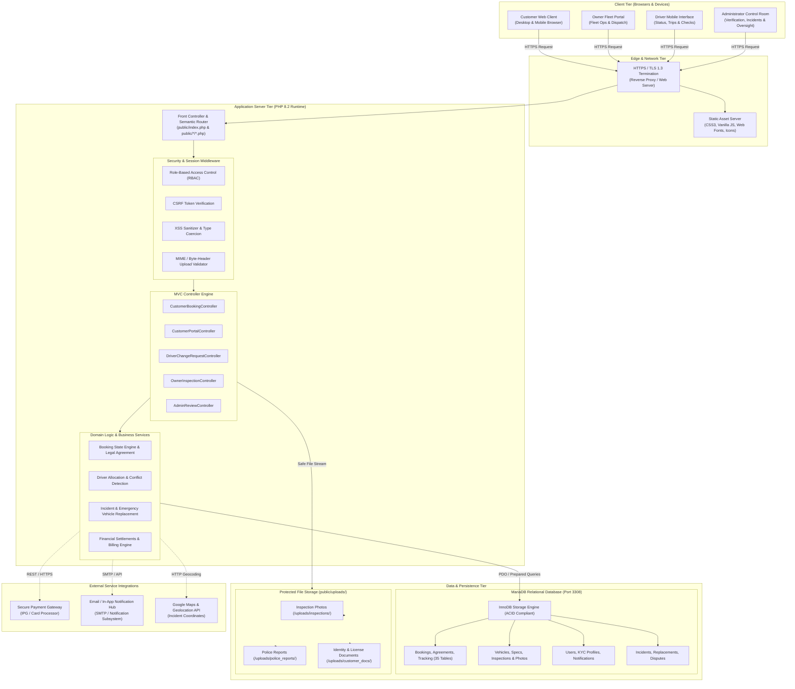

# Lanka Renters — System Architecture Diagram

## Overview
This System Architecture Diagram outlines the tiered architecture of **Lanka Renters**, showcasing the client presentation environment, network routing, application hosting tier, database layer, persistent file assets, and external gateway integration.

## Architectural Characteristics
1. **Tier Isolation**: The presentation layer remains completely decoupled from physical persistence. Controllers communicate with models via strictly typed interfaces.
2. **Defensive Storage Strategy**: All user-submitted binaries (police accident reports, pre-rental photos, driving licenses) are stored in partitioned physical directories with randomized non-enumerable naming to prevent directory traversal and arbitrary execution.
3. **Database Concurrency**: Critical workflows execute inside transactional boundaries with row-level locks to eliminate race conditions during vehicle booking, driver reassignment, and replacement vehicle allocation.
