# Lanka Renters — Activity Diagram (Complete Rental Lifecycle)

## Overview
This Activity Diagram details the end-to-end operational flow of a vehicle rental transaction in **Lanka Renters**, tracing actions across the **Customer**, **Vehicle Owner**, **Driver**, and **System/Admin** through every phase from vehicle discovery to final post-rental settlement and review.

```mermaid
flowchart TD
    Start((● Start)) --> SearchVehicles[Customer Searches & Filters Vehicles]
    SearchVehicles --> ViewSpecs[Customer Reviews Specifications\n& Pre-Booking Checklist]
    
    ViewSpecs --> CheckEligibility{Customer Identity & License\nVerified by Admin?}
    CheckEligibility -- No --> PromptKYC[Customer Submits NIC/License Documents]
    PromptKYC --> AdminReviewKYC[Admin Reviews & Approves KYC]
    AdminReviewKYC --> ViewSpecs
    
    CheckEligibility -- Yes --> FillBookingForm[Customer Enters Dates, Driver Option & Location]
    FillBookingForm --> AcceptAgreement[Customer Reviews & Checks Standard Booking Terms]
    AcceptAgreement --> SubmitBooking[Customer Submits Booking Request]
    
    SubmitBooking --> SetPending[System Records Booking: 'pending_approval'\n& Links Signed Agreement Standard_v1]
    SetPending --> NotifyOwner[System Dispatches Notification to Vehicle Owner]
    
    NotifyOwner --> OwnerReview{Owner Approves\nBooking Request?}
    OwnerReview -- No --> RejectBooking[Booking Marked 'rejected']
    RejectBooking --> EndFail((■ Terminated))
    
    OwnerReview -- Yes --> SetPendingPay[Booking Status Set to 'pending_payment']
    SetPendingPay --> CustPay[Customer Completes Payment via Gateway]
    
    CustPay --> VerifyPayment{Payment Successful?}
    VerifyPayment -- No --> CustPay
    VerifyPayment -- Yes --> SetConfirmed[Booking Marked 'confirmed'\n& Invoice Generated]
    
    SetConfirmed --> AssignDriverCheck{Booking with Driver?}
    AssignDriverCheck -- Yes --> AssignDriver[Driver Assigned & Notified]
    AssignDriverCheck -- No --> PreRentalHandover[Proceed to Vehicle Handover]
    AssignDriver --> PreRentalHandover
    
    PreRentalHandover --> OwnerPreInsp[Owner Performs Pre-Rental Inspection\n& Uploads Exterior/Interior Photos]
    OwnerPreInsp --> CustPickupConfirm[Customer Inspects Vehicle & Confirms Pickup Online]
    
    CustPickupConfirm --> SetOngoing[Booking Status Advanced to 'ongoing'\nVehicle Status: 'rented']
    
    SetOngoing --> InRentalActive[Active Rental Period]
    
    InRentalActive --> IncidentCheck{In-Trip Incident\nor Driver Change?}
    
    %% Incident Branch
    IncidentCheck -- "Road Incident Occurred" --> CustReportIncident[Customer Submits Incident Form\nwith GPS, District, Type, Photos & Police Report]
    CustReportIncident --> AdminInvestigate[Admin Reviews Incident Evidence]
    AdminInvestigate --> ResolutionDecision{Resolution Preference\n= Replacement?}
    ResolutionDecision -- Yes --> AdminAssignRep[Admin Provisions Replacement Vehicle]
    AdminAssignRep --> CustAcceptRep[Customer Accepts Replacement\nBooking Vehicle Atomically Updated]
    CustAcceptRep --> InRentalActive
    ResolutionDecision -- No --> AdminRefund[Admin Issues Pro-Rata Refund]
    AdminRefund --> CompleteReturn
    
    %% Driver Change Branch
    IncidentCheck -- "Driver Swap Requested" --> CustReqDCR[Customer Requests Alternative Driver]
    CustReqDCR --> CheckDriverSched{Replacement Driver\nFree of Conflicts & Leave?}
    CheckDriverSched -- No --> SystemBlock[System Rejects Request]
    SystemBlock --> InRentalActive
    CheckDriverSched -- Yes --> OwnerDCRReview{Owner Approves\nDriver Change?}
    OwnerDCRReview -- Yes --> AtomicSwap[System Atomically Reassigns Driver ID\n& Dispatches In-App Alerts]
    AtomicSwap --> InRentalActive
    OwnerDCRReview -- No --> InRentalActive
    
    IncidentCheck -- "No Incident / Completed Trip" --> CompleteReturn[Vehicle Returned to Owner]
    
    CompleteReturn --> OwnerPostInsp[Owner Performs Post-Rental Inspection\n& Uploads Return Photos & Odometer]
    OwnerPostInsp --> SettleOdometer{Odometer Exceeded\nMileage Limit?}
    SettleOdometer -- Yes --> AddCharge[System Calculates Excess Mileage Surcharge]
    SettleOdometer -- No --> MarkCompleted[Booking Status Advanced to 'completed'\nVehicle Status: 'available']
    AddCharge --> MarkCompleted
    
    MarkCompleted --> TriggerFinancials[System Executes Owner Settlement\n& Driver Wage Disbursement]
    TriggerFinancials --> CustReview[Customer Rates & Reviews Vehicle and Driver]
    CustReview --> EndSuccess((● End))
```

## Key Control Decisions
1. **Legal Agreement Enforcement**: The workflow strictly forbids booking submission until standard agreement terms are actively checked and accepted.
2. **Double Verification Handover**: Pre-rental inspections with photographic condition proof must be uploaded by the owner before customer pickup confirmation.
3. **Emergency Disruption Paths**: Active rentals seamlessly branch into in-trip incident handling (with replacement vehicle substitution) or driver change workflows without breaking booking continuity.
