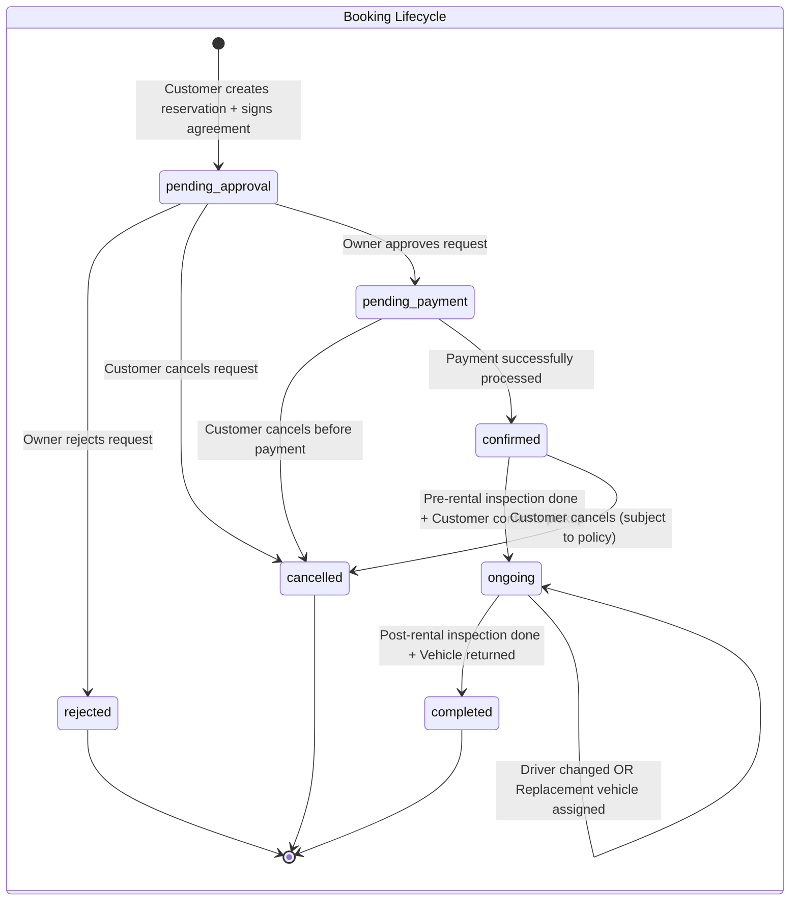
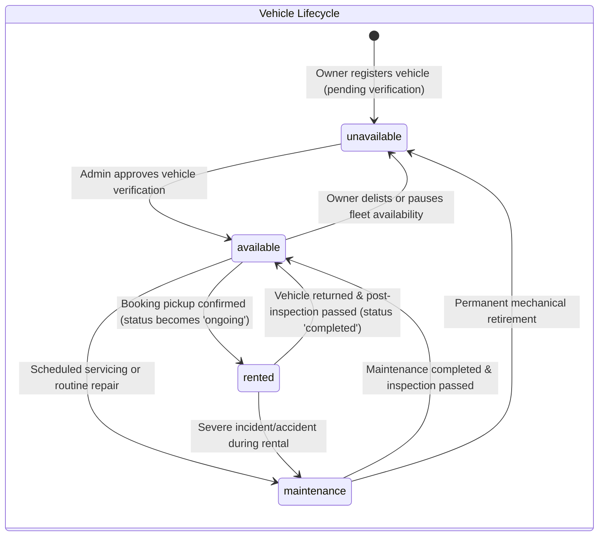
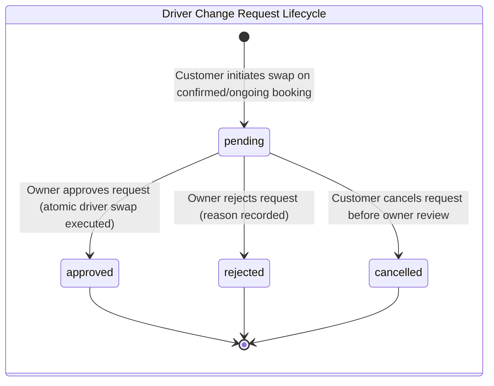
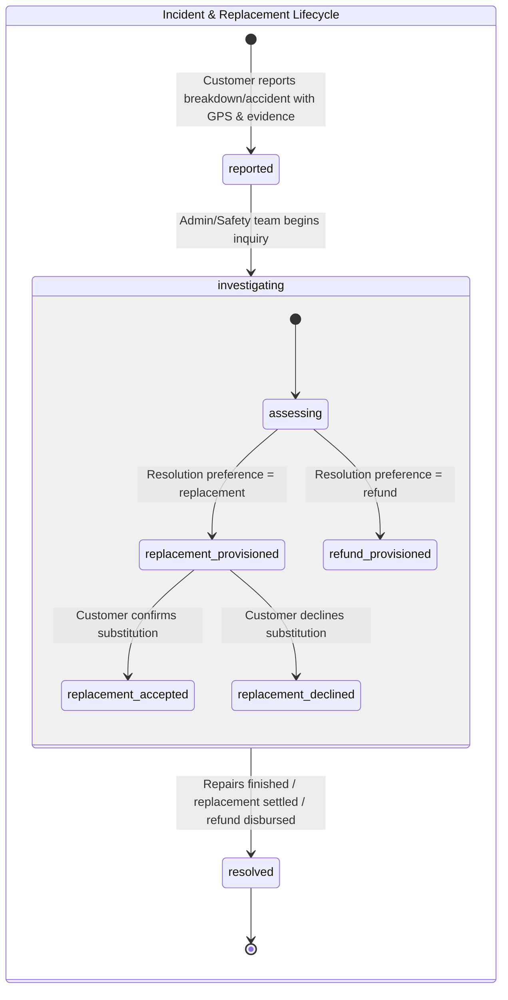
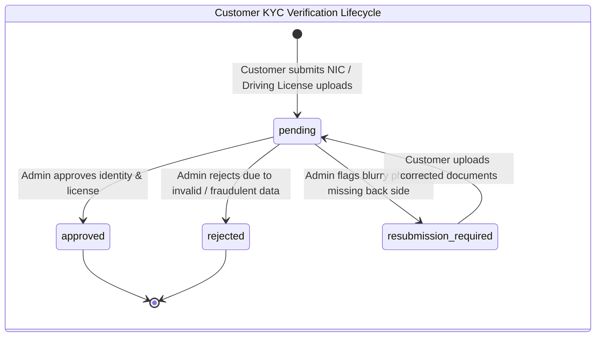

# Lanka Renters — State Machine Diagram

## Overview
This document specifies the authoritative finite state machines (FSM) governing key domain lifecycles in **Lanka Renters**: **Booking Lifecycle**, **Vehicle Lifecycle**, **Driver Change Request Lifecycle**, **Incident Lifecycle**, and **Customer KYC Lifecycle**.

## State Transition Integrity Rules
1. **No Out-of-Order Booking Advances**: A booking can never enter `ongoing` without passing through `confirmed` (payment complete) and having a signed record in `customer_booking_agreements`.
2. **Vehicle Lockout**: When a booking transitions to `ongoing`, the assigned vehicle status is synchronously locked to `rented`. It cannot be assigned to another active reservation.
3. **Driver Change Non-Disruption**: An approved driver change modifies `bookings.driver_id` in place without resetting or perturbing the active booking state (`ongoing`).
