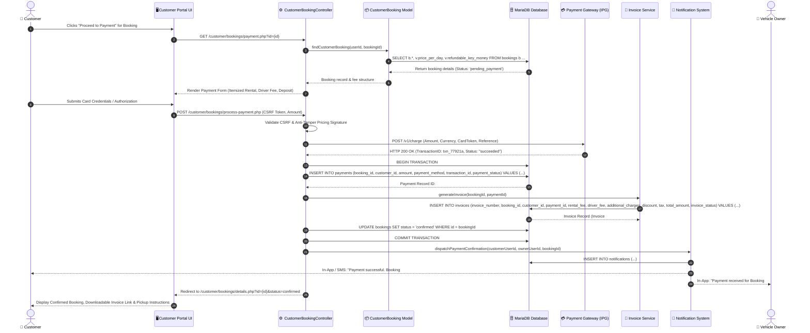

# Lanka Renters — Sequence Diagram: Payment & Invoicing Flow

## Overview
This sequence diagram illustrates the financial processing pipeline in **Lanka Renters**, beginning from customer checkout, calculation of rental fees, driver wages, key money deposits, payment gateway transaction execution, invoice generation, booking confirmation, and post-trip owner settlement.

## Financial Integrity Protections
1. **Idempotency & Replay Defense**: Each payment attempt binds to a unique transaction ID. Duplicate gateway submissions for an already confirmed booking are rejected.
2. **Atomic Invoicing**: The payment recording, invoice row creation, and booking state progression execute within a single atomic database transaction. If any sub-operation fails, the entire database transaction rolls back.
3. **Escrow & Key Money Separation**: Refundable key money deposits are tracked as dedicated liability ledger lines, ensuring rapid post-rental restitution upon clean inspection.
