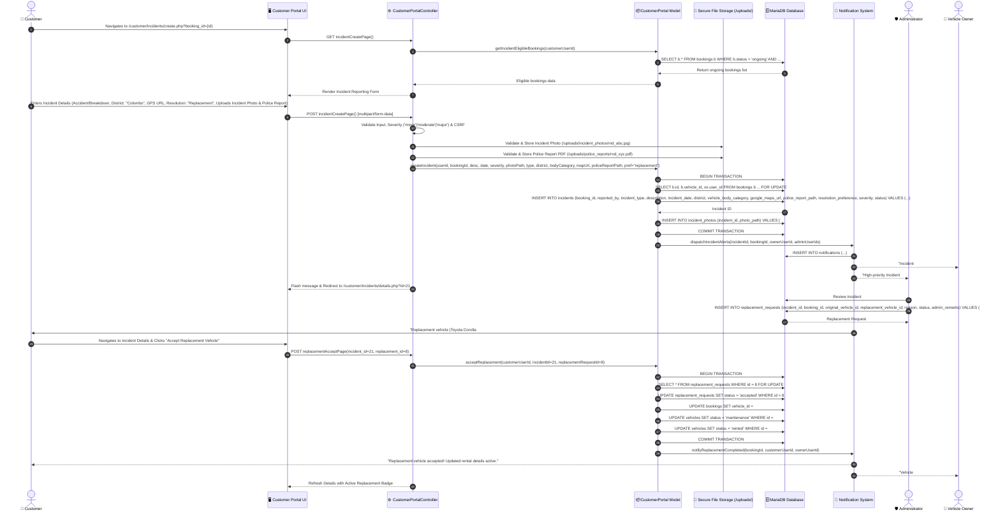

# Lanka Renters — Sequence Diagram: Incident & Replacement Flow

## Overview
This sequence diagram illustrates the lifecycle of an in-rental emergency road incident and subsequent vehicle replacement in **Lanka Renters**, showcasing multi-party interactions across the **Customer**, **Customer Portal Controller**, **Secure Upload Storage**, **MariaDB**, **Administrator**, and **Fleet Owner**.

## Fault-Tolerant File & Transaction Isolation
1. **Compensating Upload Deletion**: If the database transaction fails during incident creation, uploaded files are cleanly deleted from the filesystem (`$this->deletePoliceReport()`, `$this->deleteIncidentPhoto()`).
2. **Pessimistic Locking**: `CustomerPortal::acceptReplacement` executes with `FOR UPDATE` locks on both the incident, booking, and replacement request rows to prevent concurrent vehicle race conditions.
3. **Audit Trail**: Every state transition between initial reporting, police documentation, admin provisioning, and customer sign-off is indelibly timestamped.
