# Lanka Renters — Sequence Diagram: Driver Change Request Flow

## Overview
This sequence diagram details the end-to-end operational execution of the **Driver Change Request (DCR)** subsystem in **Lanka Renters**, tracing actions from Customer request submission through availability validation, Owner review, transactional driver reassignment, and tripartite notification dispatch.

```mermaid
sequenceDiagram
    autonumber
    actor Customer as 👤 Customer
    participant UI as 🖥️ Customer Booking UI
    participant Ctrl as ⚙️ DriverChangeRequestController
    participant ModelDCR as 📦 DriverChangeRequest Model
    participant DB as 🗄️ MariaDB Database
    participant Notif as 🔔 Notification System
    actor Owner as 👤 Vehicle Owner
    actor PrevDriver as 🚗 Previous Driver
    actor NewDriver as 🚗 New Driver

    Customer ->> UI: Clicks "Request Driver Change" on Booking #ID
    UI ->> Ctrl: GET /customer/bookings/driver-change.php?booking_id={id}
    Ctrl ->> ModelDCR: getEligibleReplacementDrivers(bookingId)
    ModelDCR ->> DB: SELECT d.*, u.name FROM drivers d JOIN users u ON u.id = d.user_id WHERE d.availability_status = 'available' AND d.verification_status = 'approved' AND d.id NOT IN (SELECT driver_id FROM bookings WHERE status IN ('confirmed','ongoing') AND ...)
    DB -->> ModelDCR: List of eligible, conflict-free drivers
    ModelDCR -->> Ctrl: Available drivers list
    Ctrl -->> UI: Render Driver Change Modal with Available Drivers Dropdown & Reason Field

    Customer ->> UI: Selects New Driver #15, Enters Reason ("Language preference / route expertise"), Submits
    UI ->> Ctrl: POST /customer/bookings/driver-change.php (booking_id, requested_driver_id, reason, CSRF)
    
    Ctrl ->> Ctrl: Validate CSRF, Booking Eligibility ('confirmed' | 'ongoing'), Customer Ownership
    Ctrl ->> ModelDCR: createRequest(customerUserId, bookingId, requestedDriverId=15, reason)

    ModelDCR ->> DB: BEGIN TRANSACTION
    ModelDCR ->> DB: Check for existing pending request: SELECT COUNT(*) FROM driver_change_requests WHERE booking_id = ? AND status = 'pending' FOR UPDATE
    ModelDCR ->> DB: Verify requested driver availability & active leave conflicts: SELECT COUNT(*) FROM driver_leaves WHERE driver_id = 15 AND status = 'approved' AND ...
    ModelDCR ->> DB: INSERT INTO driver_change_requests (booking_id, requested_by, current_driver_id, requested_driver_id, reason, status) VALUES (#bk_12, #u_cust, #dr_14, #dr_15, 'Language preference', 'pending')
    DB -->> ModelDCR: Request ID: #dcr_19
    ModelDCR ->> DB: COMMIT TRANSACTION

    ModelDCR ->> Notif: notifyOwnerOfDriverChangeRequest(ownerUserId, #dcr_19)
    Notif ->> DB: INSERT INTO notifications (user_id, title, message, notification_type, related_id) VALUES (...)
    Notif -->> Owner: In-App / Push: "Customer requested driver change for Booking #12. Please review."

    Ctrl -->> UI: Flash success & Render "Pending Owner Review" Badge in Booking Actions

    %% Owner Review & Approval Flow
    Owner ->> UI: Navigates to Owner Portal / Bookings / Driver Change Requests
    UI ->> Ctrl: GET /owner/driver-change-requests/details.php?id=19
    Ctrl -->> UI: Display Current Driver (#14), Candidate Driver (#15), Customer Reason, Booking Schedule

    Owner ->> UI: Enters Remarks ("Approved as requested"), Clicks "Approve Driver Change"
    UI ->> Ctrl: POST /owner/driver-change-requests/approve.php (request_id=19, owner_remarks, CSRF)
    Ctrl ->> Ctrl: Validate Owner Ownership of Fleet Vehicle & CSRF
    
    Ctrl ->> ModelDCR: approveRequest(ownerUserId, requestId=19, remarks)
    ModelDCR ->> DB: BEGIN TRANSACTION
    ModelDCR ->> DB: SELECT * FROM driver_change_requests WHERE id = 19 FOR UPDATE
    ModelDCR ->> DB: Verify Candidate Driver #15 still available (re-check conflict race condition)
    ModelDCR ->> DB: UPDATE driver_change_requests SET status = 'approved', owner_remarks = 'Approved as requested', reviewed_by = #u_owner, reviewed_at = NOW() WHERE id = 19
    ModelDCR ->> DB: UPDATE bookings SET driver_id = 15 WHERE id = #bk_12
    ModelDCR ->> DB: COMMIT TRANSACTION

    %% Multi-Party Notifications
    ModelDCR ->> Notif: dispatchDriverChangeApprovalAlerts(#bk_12, #u_cust, #dr_14, #dr_15)
    Notif ->> DB: INSERT INTO notifications (Batched for Customer, Driver 14, Driver 15)
    Notif -->> Customer: "Driver Change Approved! Driver #15 is now assigned to your booking."
    Notif -->> PrevDriver: "Assignment Update: You have been relieved from Booking #12."
    Notif -->> NewDriver: "New Trip Assignment: You are assigned to Booking #12. Check trip schedule."

    Ctrl -->> UI: Redirect with Success Notification
    UI -->> Owner: Render Updated Booking with Driver #15 Assigned
```

## Concurrency & Business Rules
1. **Pending Request Mutex**: Only one active pending driver change request may exist per booking at any given time. Duplicate submissions are strictly blocked at both the database and model layers.
2. **Leave & Conflict Enforcement**: Candidate drivers on scheduled leaves or conflicting active booking dates are barred from selection.
3. **Preservation of Core Booking Invariants**: The active booking status (`confirmed` or `ongoing`) and customer pickup confirmation status remain untouched; only `bookings.driver_id` changes.
